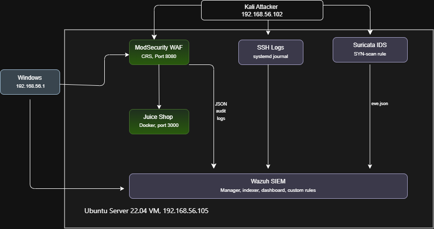

# SOC Home Lab: WAF, Network and SSH Attack Detection with Wazuh

A small, isolated lab where I attack a deliberately vulnerable web app (OWASP Juice Shop) from Kali Linux, block the attacks with a ModSecurity WAF, and detect them in the Wazuh SIEM using custom rules mapped to MITRE ATT&CK.

**Result:** 6 attack types run from Kali and detected in Wazuh with the correct attacker IP; 7 custom Wazuh rules and 1 custom Suricata rule written; 1 false positive found and tuned out; 1 gap documented (raw path traversal is rejected by nginx before the WAF sees it).

## Architecture

- Network: host-only adapter for lab traffic, NAT adapter for updates.
- Host: 12 GB RAM, VirtualBox. Ubuntu VM 6 GB RAM / 50 GB disk, Kali VM 2 GB RAM.
- Kali attacks the WAF (web), SSH, and the network (Nmap). The Windows host browses the app through the WAF on port 8080 and opens the Wazuh dashboard directly.

## Tools

| Tool | Purpose |
|---|---|
| Wazuh 4.14 (all-in-one) | SIEM, log analysis, alerting |
| OWASP Juice Shop (Docker) | Vulnerable target app |
| ModSecurity + OWASP CRS (`owasp/modsecurity-crs:nginx`) | WAF, paranoia level 1, JSON audit log |
| Suricata 8 (ET Open rules + custom rule) | Network IDS, port-scan detection |
| Kali Linux, curl, Hydra, Nmap | Attacker tooling |

## Detections

Full table with payloads: [attack-simulations/attack-to-detection-map.md](attack-simulations/attack-to-detection-map.md)

| Attack | ATT&CK | Rules | Outcome |
|---|---|---|---|
| XSS | T1190 | Wazuh 100204 | Blocked (403), detected |
| SQL injection | T1190 | Wazuh 100203 | Blocked (403), detected |
| Scanner user-agent (sqlmap) | T1595.002 | Wazuh 100202 | Blocked (403), detected |
| Path traversal (query string) | T1190 | Wazuh 100205 | Blocked (403), detected |
| SSH brute force | T1110.001 | Wazuh 5710, 5503, 2502, 5758, 5712 (built-in) | Detected |
| Nmap SYN port scan | T1046 | Suricata sid 9000001 (custom) -> Wazuh 100300 (custom) | Detected, tuned for one false positive |
| Raw `/../../etc/passwd` path | n/a | none | Rejected by nginx (400) before the WAF, no alert |

Custom rules:
- Wazuh: [detections/wazuh/local_rules.xml](detections/wazuh/local_rules.xml)
- Suricata: [detections/suricata/local.rules](detections/suricata/local.rules)

## Screenshots

| Evidence | File |
|---|---|
| WAF alerts from Kali, rules 100202-100205 | `screenshots/05-waf-alerts-kali-ip.png` |
| SSH brute force events | `screenshots/06-ssh-bruteforce-events.png` |
| SSH brute force rule 5712 | `screenshots/07-ssh-rule-5712.png` |
| Kali routing fix | `screenshots/08-kali-routing-fix.png` |
| Nmap scan detected, rule 100300 | `screenshots/09-nmap-detection-100300.png` |
| Nmap rule false positive (Windows host) and tuned result | `screenshots/10-nmap-false-positive.png` |

## Lessons learned

See [docs/lessons-learned.md](docs/lessons-learned.md). Highlights:
- Alerts first showed the wrong attacker IP because of NAT routing on Kali.
- Wazuh failed on unsupported Ubuntu 26.04 and then on a full disk.
- nginx rejects malformed paths before the WAF.
- My first Nmap rule alerted on my own Windows host's browser traffic. I excluded that host and documented the trade-off.

## Limitations

- ModSecurity runs at paranoia level 1, so it blocks common payloads but I have not yet tested evasion techniques.
- My web rules key off the WAF's 403 response, so they would not alert if the WAF ran in detection-only mode.
- Single-host lab: target, WAF, and SIEM share one VM.
- The Nmap rule is a simple SYN-rate threshold (20 SYNs in 5 seconds per source). Slow scans would evade it. I excluded my Windows host (`192.168.56.1`) to stop false positives, so a real scan from that IP would also go undetected.

## Reproducing

1. Create VirtualBox VMs: Ubuntu Server 22.04 (6 GB RAM, 50 GB disk) and Kali, each with a NAT and a host-only adapter. After install, extend the LVM volume to use the whole disk.
2. Install Wazuh: `curl -sO https://packages.wazuh.com/4.14/wazuh-install.sh && sudo bash ./wazuh-install.sh -a`
3. Run Juice Shop and the WAF in Docker on a shared network (`docker network create labnet`), with the WAF audit log in JSON format mounted to a host folder.
4. Add the log path as a `<localfile>` (log_format `json`) in `/var/ossec/etc/ossec.conf`.
5. Install Suricata, copy `detections/suricata/local.rules` to `/var/lib/suricata/rules/`, make sure `local.rules` is listed under `rule-files` in `suricata.yaml`, and restart Suricata. Wazuh reads Suricata's `eve.json`.
6. Copy `detections/wazuh/local_rules.xml` to `/var/ossec/etc/rules/` and restart `wazuh-manager`.
